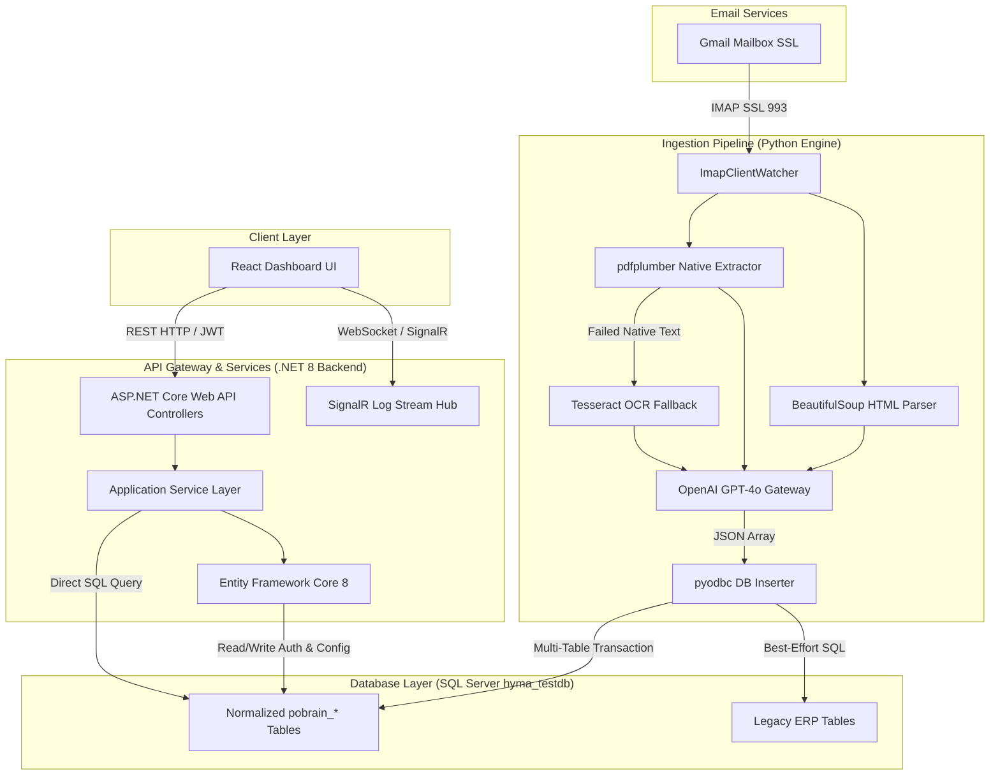
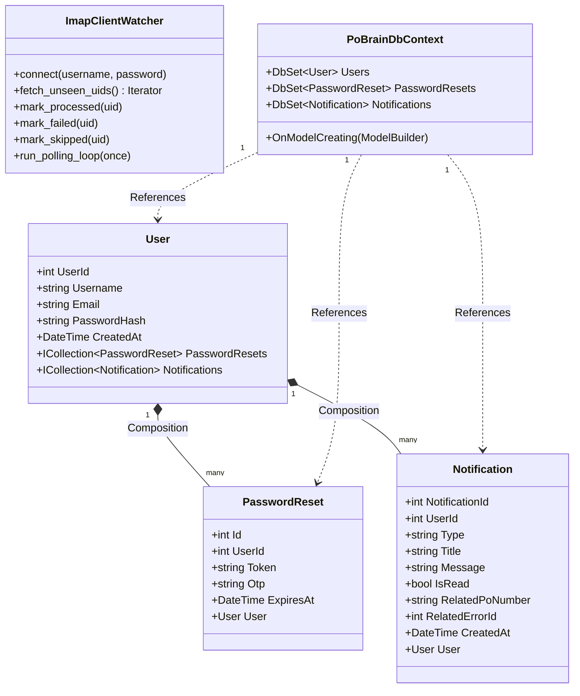
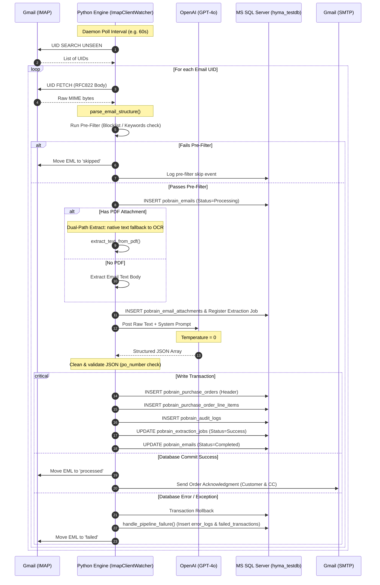
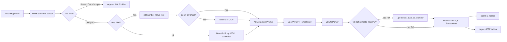
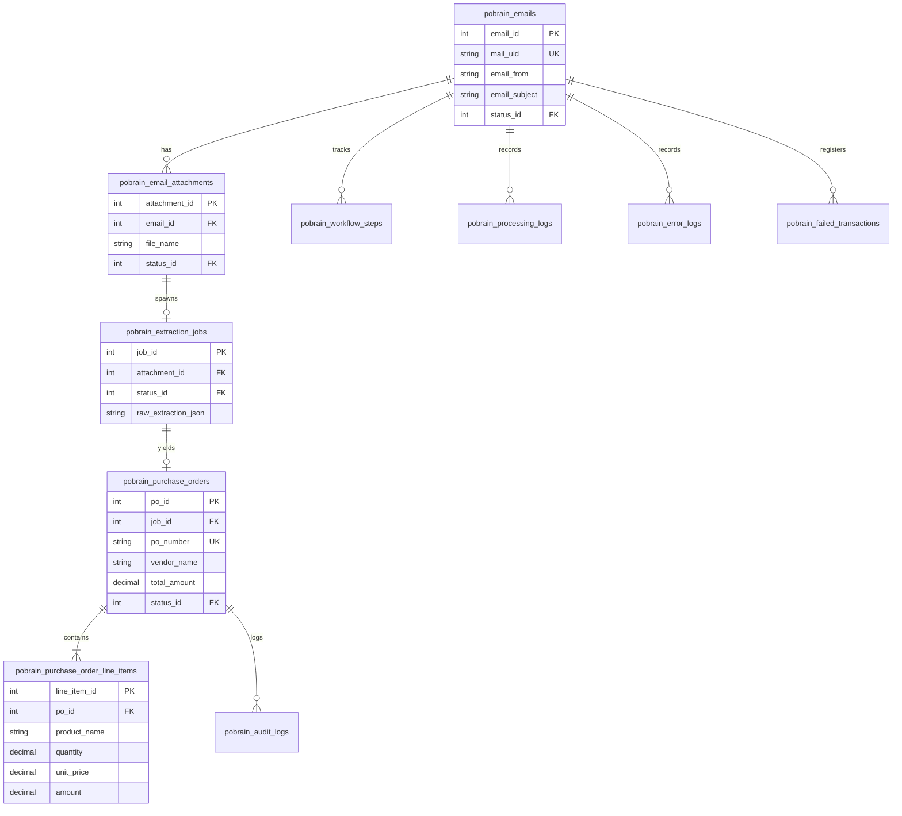
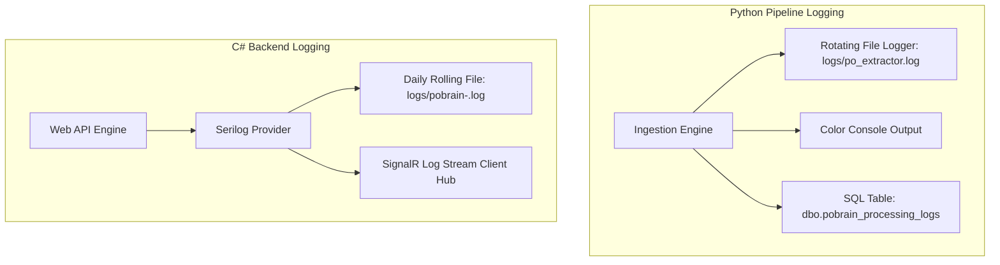
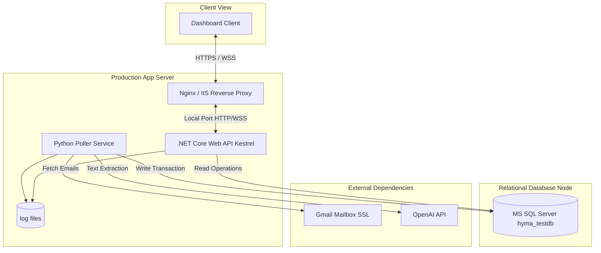

# Technical Architecture Document (TAD) — PO-Brain System

---

## 1. Executive Summary

### 1.1 Purpose of the Application
The **PO-Brain System** is an enterprise-grade, automated cognitive data extraction and operations monitoring platform designed to ingest, process, structure, and integrate raw purchase orders (POs). The primary goal is to eliminate manual data entry, reduce transaction processing cycle times, and resolve high-error operational issues associated with custom vendor PO formats (formal tables, unstructured conversational emails, and scanned image attachments).

### 1.2 Business Objective
*   **Operational Efficiency:** Automate ingestion loops, reducing human processing time by >90%.
*   **Data Integrity & Normalization:** Map diverse, highly variable order structures (unstructured email bodies, PDF formats) into a strict, unified 3rd Normal Form (3NF) relational model.
*   **ERP Interoperability:** Automatically sync extraction outcomes with legacy enterprise resource planning (ERP) order records.
*   **Operational Monitoring:** Expose a dashboard displaying live log streams, health checks, failed transactions, and audit histories.

### 1.3 High-Level Overview
PO-Brain uses a distributed-agent pattern:
1.  **Ingestion & Parsing (Python Core):** An asynchronous poller monitoring branch email accounts (IMAP/SSL). It parses emails and extracts PDF attachments (with OCR fallback).
2.  **Cognitive Extraction (OpenAI GPT-4o):** Employs prompt engineering and zero-temperature models to deserialize raw texts into validated, structured JSON formats.
3.  **Relational Database (Microsoft SQL Server):** Multi-table transactions storing data in the `pobrain_` schema.
4.  **Backend Web API (.NET 8):** Bridges database resources to the frontend client, handling authentication, notifications, exports, and real-time operations telemetry.
5.  **Frontend Dashboard (React + TypeScript):** Standardized portal for operational visibility and validation.

### 1.4 Main Features
*   **Dual-Path PDF Parsing:** Layout-aware native text extraction with automatic fallback to high-resolution rasterization and Tesseract OCR.
*   **Heuristic Pre-Filtering:** Prevents non-PO emails (newsletters, notifications) from triggering costly AI calls.
*   **Strict Transaction Isolation:** Uses database transactions to ensure email statuses, job runs, PO headers, and line items commit atomically.
*   **Real-time Event Streaming:** Streams system logs and health telemetry using ASP.NET Core SignalR.
*   **Auditing & Workflows:** Tracks step-by-step metrics (`pobrain_workflow_steps`) and captures master records changes.

### 1.5 Intended Users
*   **Operations & Order Desk Clerks:** Validate failed transactions and monitor order ingestion status.
*   **Systems Architects & DevOps Engineers:** Track system throughput, health, database connectivity, and logs.
*   **QA Engineers:** Verify pipeline stability and data mappings against seed data.

---

## 2. Project Overview

### 2.1 Technology Stack
*   **Ingestion Pipeline Language:** Python 3.8+
*   **Web API Runtime:** .NET 8 (ASP.NET Core / Entity Framework Core 8)
*   **Frontend UI Library:** React 18+ / TypeScript / Vite / TailwindCSS / shadcn/ui
*   **Database Engine:** Microsoft SQL Server 2019+

### 2.2 Frameworks, Libraries, and Third-Party API integrations
*   **Python Dependencies:**
    *   `pyodbc` (ODBC Driver 17): Enterprise SQL Server integration.
    *   `pdfplumber`: Layout-aware PDF text extraction.
    *   `pytesseract` + `pdf2image` + `Pillow`: Fallback OCR pipeline.
    *   `BeautifulSoup` (`lxml`): HTML cleanup.
    *   `openai`: GPT-4o structured extraction gateway.
    *   `tenacity`: Adaptive retries with exponential backoff.
    *   `colorlog`: High-precision logging console output.
*   **C# .NET Dependencies:**
    *   `Microsoft.EntityFrameworkCore.SqlServer` (EF Core 8): Database provider.
    *   `Serilog.AspNetCore` + `Serilog.Sinks.File`: File and console log rolling provider.
    *   `Microsoft.AspNetCore.Authentication.JwtBearer`: Token authentication.
    *   `Swashbuckle.AspNetCore` (Swagger/OpenAPI v1): Documentation and testing.
*   **External APIs & Services:**
    *   `OpenAI API`: Structured JSON text extraction.
    *   `Gmail IMAP/SMTP`: Email polling (IMAP SSL 993) and notifications (SMTP 587 TLS).

---

## 3. Overall System Architecture

The PO-Brain architecture is built on a decoupled, event-driven, and layered enterprise system model.



### 3.1 Layered Architecture
1.  **Ingestion/Parser Layer (Python Core):** Fetches unseen emails via IMAP, decodes headers/parts, extracts text, handles OCR, and routes raw data to the AI model.
2.  **Cognitive Model Layer (OpenAI API):** Formulates prompts and enforces structure to convert unstructured text into unified JSON array payloads.
3.  **Application Layer (.NET 8 Backend):** Controls authorization, fetches tracking details, updates notification flags, and streams logs over WebSocket.
4.  **Database Persistence Layer (SQL Server):** A normalized relational schema acting as the source of truth, with tables structured for emails, jobs, line items, and audit trails.

---

## 4. Source Code Structure

### 4.1 Folder Tree
```
PO-Brain/
├── .vscode/                   # VS Code configuration
├── Backend/                   # ASP.NET Core 8 Web API Project
│   ├── Controllers/           # REST Endpoints
│   ├── Data/                  # DB Context and Entity Models
│   ├── Hubs/                  # SignalR Hubs (WebSockets)
│   ├── Services/              # Core business services & interfaces
│   ├── Program.cs             # API bootstrapping & DI configuration
│   └── appsettings.json       # App configuration
├── Database/                  # Relational Schema Creation & Migrations
│   ├── 01_create_tables.sql   # pobrain_ tables DDL
│   ├── 02_foreign_keys.sql    # Relational integrity rules
│   ├── 03_indexes.sql         # Query optimization indexes
│   ├── 04_seed_data.sql       # Reference lookups
│   └── ...                    # Migrations & views
├── Extraction_file/           # Python ingestion pipeline
│   ├── unified_po_extractor.py# Main production poller
│   ├── requirements.txt       # Python environment specifications
│   ├── PRD.md                 # Product Requirements Document
│   └── logs/                  # Local execution logs
└── Web/                       # Frontend application
    └── PO-Brain/              # React TS Vite SPA Dashboard
```

### 4.2 Folder Responsibilities and File Breakdown
*   **`Extraction_file/`**: Houses the ingestion engine. It is responsible for mailbox connectivity, document processing, and database persistence.
    *   [unified_po_extractor.py](file:///e:/narayana/PO-Brain/Extraction_file/unified_po_extractor.py): The main execution script containing the IMAP daemon loop, PDF processing logic, OpenAI client wrapper, and SQL Server transaction code.
*   **`Backend/`**: Exposes endpoints for UI binding, real-time logging, and operational management.
    *   `Controllers/`: Defines REST endpoints (`AuthController`, `DashboardController`, `ExtractionsController`, `FailedTransactionsController`, `LogsController`, `NotificationsController`).
    *   `Data/Entities/`: Maps database schemas (`User`, `PasswordReset`, `Notification`) using EF Core.
    *   `Services/`: Encapsulates business logic such as dashboard KPI calculations, JWT issuance, log streaming, and email alerts.
*   **`Database/`**: Manages the life cycle of the relational schema. It holds the SQL DDL statements and data modifications required to build the system.

---

## 5. Module Architecture (Python Ingestion)

The [unified_po_extractor.py](file:///e:/narayana/PO-Brain/Extraction_file/unified_po_extractor.py) script contains several cohesive sub-modules and functions, explained below:

### 5.1 Configuration Block
*   **Purpose:** Establishes application limits, secrets, database server parameters, and toggle settings.
*   **Responsibilities:** Loads hardcoded credential lists (scheduled for conversion to environment variables), defines IMAP endpoints, and configures features such as `ENABLE_PO_PREFILTER` and `ENABLE_LEGACY_ERP_INSERT`.

### 5.2 Logging Sub-Module (`_setup_logger`)
*   **Purpose:** Configures diagnostic output.
*   **Responsibilities:** Bootstraps console outputs with ANSI colors (`colorlog`) and registers a daily rotating log file (`RotatingFileHandler` up to 10MB, retaining 5 backups).

### 5.3 Ingestion Engine (`ImapClientWatcher`)
*   **Purpose:** Handles IMAP mailbox actions.
*   **Responsibilities:** 
    *   Establishes SSL connections to mail servers.
    *   Scans target folders for `UNSEEN` items using UIDs.
    *   Moves messages between folders (`processed`, `failed`, `skipped`) using IMAP copy and delete actions.
    *   Runs the continuous polling loop across multiple branch mailboxes (Hyderabad and Bangalore).

### 5.4 Document Parsing Engine
*   **`parse_email_structure`:** Traverses raw MIME payloads, decodes headers (using RFC2047 rules), cleans up HTML with `BeautifulSoup`, and extracts PDF attachments.
*   **`extract_text_from_pdf`:** Controls PDF parsing. It first attempts native layout extraction using `pdfplumber`. If the extracted string contains fewer than 50 characters, it falls back to `pdf2image` and Tesseract OCR.

### 5.5 AI Engine (`extract_data_via_openai`)
*   **Purpose:** Interface for unstructured-to-structured text conversion.
*   **Responsibilities:** Sends extracted raw text alongside a structured prompt (`_SYSTEM_PROMPT`) to the OpenAI GPT-4o model. Enforces structured JSON output and uses `tenacity` for resilience against API failures.

### 5.6 Persistence Layer (`save_parsed_data_to_db`)
*   **Purpose:** Saves extraction results into the database.
*   **Responsibilities:** Operates within a SQL transaction to write data into tables such as `pobrain_emails`, `pobrain_purchase_orders`, and `pobrain_purchase_order_line_items`. Includes checking for duplicates and looking up company metrics, customer PersonIDs, and catalog items.

---

## 6. Class Diagram

The following diagram illustrates the relationship between the C# API layers and the database entities, alongside the Python ingestion classes.



---

## 7. Sequence Diagrams

### 7.1 Automated Ingestion and Cognitive Processing Pipeline
This sequence diagram shows the end-to-end flow of an email being ingested by the Python pipeline, parsed by GPT-4o, and persisted into SQL Server.



---

## 8. Data Flow Diagram



---

## 9. Database Architecture

### 9.1 Entity Relationship Diagram
The database `hyma_testdb` implements a normalized 3rd Normal Form (3NF) relational layout consisting of 18 tables under the `dbo` schema, prefixed with `pobrain_`.



### 9.2 Key Tables and Structural Rules
*   **`dbo.pobrain_emails`:** Tracks ingested emails. `mail_uid` holds the Gmail UID to prevent reprocessing.
*   **`dbo.pobrain_email_attachments`:** Stores document metadata and records whether OCR was used.
*   **`dbo.pobrain_extraction_jobs`:** Details API execution metrics, tokens used, and contains the raw response payload in `raw_extraction_json`.
*   **`dbo.pobrain_purchase_orders`:** Records order header fields including billing locations, branch references, and computed financial totals.
*   **`dbo.pobrain_purchase_order_line_items`:** Lists ordered products. Columns store parsed chemical properties (such as CAS and CAT numbers) along with line-level tax and discount values.

### 9.3 Indexes, Constraints, and Time Zones
*   **Indexes:** Structured indexes are defined on frequently queried foreign keys (`po_id`, `email_id`), tracking states (`status_id`), and unique identifiers (`po_number`, `mail_uid`).
*   **Time Zone Rule:** All dates are stored in Indian Standard Time (IST, UTC+5:30). Python enforces this timezone constraint via `now_ist()`, and SQL defaults map to `DATEADD(MINUTE, 330, GETUTCDATE())`.

---

## 10. API Architecture

The backend API is built on .NET 8, acting as a secure data layer for the React dashboard.

### 10.1 Key Endpoints
*   **`POST /api/auth/login`:** Validates user credentials and issues a JWT token.
*   **`GET /api/dashboard/kpis`:** Provides metrics such as daily extraction volume and system success rates.
*   **`GET /api/extractions`:** Returns lists of extracted line items, supporting pagination, searching, and filtering.
*   **`GET /api/failedtransactions`:** Lists jobs that failed validation or parsing.
*   **`GET /api/logs`:** Exposes historical execution logs.

### 10.2 Authentication, CORS, and WebSocket Streaming
*   **JWT Bearer Scheme:** Enforces validation on incoming request headers. It supports parsing tokens with or without the `Bearer ` prefix.
*   **CORS Settings:** Access is controlled by allowed origins defined in the `AllowedOrigins` configuration.
*   **Real-time Log Streaming:** SignalR Hub (`LogStreamHub`) mapped to `/hubs/logs` streams logging statements directly to connected dashboard clients.

---

## 11. Design Patterns

The codebase leverages several software engineering design patterns:

1.  **Repository / Query Object Pattern:** The .NET backend services run direct SQL queries via EF Core's `SqlQuery<T>` to fetch dashboard statistics and extraction tables.
2.  **Background Worker / Hosted Service:** The backend runs a `HealthBroadcastService` to broadcast system health diagnostics via SignalR at fixed intervals.
3.  **Active Daemon / Poller Loop:** The Python engine implements a polling loop to scan branch mailboxes and process incoming messages sequentially.
4.  **Chain of Responsibility (Document Parsing):** Handlers are chained together during document ingestion (Header Parsing -> HTML Sanitization -> Native PDF extraction -> OCR fallback).
5.  **Fallback / Circuit Breaker Policy:** The PDF extractor switches to OCR if native text extraction yields sparse results.
6.  **Dependency Injection:** Configured in `Program.cs` to manage the lifetimes of controllers, database contexts, and services.

---

## 12. Business Logic & Processing Pipeline

The ingestion pipeline handles raw emails using a series of parsing and validation rules:

```
[Raw Email] 
   │
   ▼
[Relevance Filter] ── Skip if Sender Blocked or No PO Keyword/PDF
   │
   ▼
[Document Parsing] ── Extract text (Native or OCR fallback)
   │
   ▼
[AI Structured Extraction] ── GPT-4o extracts standard PO fields
   │
   ▼
[Validation Gate] ── Assign Auto-PO number if missing PO number
   │
   ▼
[DB Master-Data Lookup] ── Map client to PersonID, resolve CAS/CAT to CatalogNo/GST
   │
   ▼
[Transactional DB Insert] ── Write Header, Line Items, and Audit Logs
```

### 12.1 Master-Data Lookup and Enrichment
Before saving parsed items to the database, the pipeline queries reference tables to enrich the record details:
*   **Customer Lookup:** Resolves a buyer's email to their `PersonID`, `CompanyCode`, and `Discount` percentage from `dbo.tblRegistration`.
*   **Catalog No Resolution:** Matches CAS numbers or product names to catalog numbers in `dbo.tblCatalogMaster`.
*   **Pack Code Resolution:** Resolves pack sizes to ERP-compatible codes using `dbo.tblPackSizeMaster`.
*   **GST Rate Resolution:** Matches CAS numbers or catalog entries against `dbo.tblGSTRateMaster` to determine tax rates.

---

## 13. Configuration Management

Both components manage application configurations using file-based settings and code constants:

### 13.1 Python Ingestion Configurations
Configurations are defined as constants at the top of [unified_po_extractor.py](file:///e:/narayana/PO-Brain/Extraction_file/unified_po_extractor.py):
*   **API Credentials:** `OPENAI_API_KEY`, model definitions.
*   **Mail Server Settings:** Server ports, credentials, folder paths, and mailbox configs.
*   **Database Settings:** Connection parameters and ODBC driver configurations.
*   **Pipeline Switches:** `ENABLE_PO_PREFILTER` and `ENABLE_LEGACY_ERP_INSERT`.

### 13.2 .NET Web API Configurations
Managed via `appsettings.json`:
*   `ConnectionStrings:DefaultConnection`: Connection string for SQL Server.
*   `JwtSettings`: JWT secret keys, issuer parameters, and expiration timings.
*   `CorsSettings:AllowedOrigins`: Allowed origins for API requests.

---

## 14. Logging Architecture

The system implements logging across both the Python engine and the C# Web API:



### 14.1 Python Ingestion Logging
*   Uses a daily rotating log file (`logs/po_extractor.log`) that retains up to 5 backups of 10MB each.
*   Writes structured, operational log events directly to the database in `dbo.pobrain_processing_logs`.

### 14.2 .NET API Logging
*   Serilog manages logging to console and rolling files (`logs/pobrain-.log`) with a 30-day retention window.
*   The `LogStreamHub` streams API events and logs to dashboard clients in real-time.

---

## 15. Error Handling

The system defines fallback mechanisms and logging procedures for handling pipeline errors:

### 15.1 Pipeline Failures (`handle_pipeline_failure`)
If an exception occurs during processing, the pipeline runs a fallback routine:
*   Marks the email record status as `Failed` (status ID 4) and saves the error message.
*   Writes details of the exception to `dbo.pobrain_error_logs`.
*   Creates a user-facing entry in `dbo.pobrain_failed_transactions` to track the failed PO for manual review.
*   Moves the email to the `failed` IMAP folder.

### 15.2 API Error Handling
*   Returns standardized JSON error responses with clear status codes (e.g., `401 Unauthorized` for bad logins, `404 Not Found` for missing resources).

---

## 16. Security Architecture

The application implements security practices across data ingestion, API access, and storage layers:

*   **Email Security:** Connects to Gmail mailboxes using IMAP over SSL on port 993, with credentials managed via secure app passwords.
*   **Authentication & Authorization:** Secure JWT tokens authorize access to REST and SignalR endpoints. Passwords are saved as secure hashes using standard hashing algorithms.
*   **CORS Policies:** Restricts cross-origin resource sharing to trusted client origins defined in the configuration.
*   **Database Queries:** The services protect against SQL injection by using parameterized inputs in Entity Framework's `SqlQuery` methods.

---

## 17. Performance & Optimization

The system implements optimization techniques to handle file processing and database queries:

*   **Dual-Path Parsing:** PDF files are processed using layout-aware native extraction. The system only runs OCR when native text extraction is unsuccessful, saving system resources.
*   **Connection Lifecycle:** Uses short-lived pyodbc connection pools in Python and scoped DbContext lifecycles in .NET to prevent resource leaks.
*   **Database Indexing:** Index coverage on tables like `purchase_orders` and `line_items` speeds up query processing times during operations.

---

## 18. Scalability

The components are designed to scale as data volumes grow:

*   **Pipeline Portability:** The Python extraction engine is decoupled from the database and API. It can run as a background service, inside a Docker container, or as a serverless function (such as AWS Lambda or Azure Functions).
*   **Branch Partitioning:** Processes mailboxes sequentially. If mailbox volumes increase, the system can scale out to run parallel instances for each branch.
*   **Stateless API:** The .NET backend is stateless and can run behind load balancers (such as Nginx or AWS ALBs) in clustered environments.

---

## 19. Deployment Architecture



*   **Nginx Reverse Proxy:** Manages HTTPS traffic and routes requests to the backend Web API.
*   **Python Poller Daemon:** Deployed as a background service (using systemd or Windows Services) that runs continuously.
*   **Database Server:** SQL Server runs on a dedicated database node with network access controls.

---

## 20. Code Dependencies & Alternatives

| Dependency | Purpose | Alternatives Considered |
|:---|:---|:---|
| `pdfplumber` | Layout-aware PDF text extraction | `PyPDF2` (lacks layout parsing), `pdfminer.five` |
| `pytesseract` | OCR fallback for scanned images | `EasyOCR`, cloud-based OCR APIs (e.g. AWS Textract) |
| `OpenAI GPT-4o` | Cognitive structured extraction | Claude 3.5 Sonnet, local LLMs (e.g., Llama 3) |
| `pyodbc` | SQL Server database connectivity | `pymssql` |
| `Entity Framework Core 8` | Backend database queries | `Dapper` (faster, but lacks change tracking) |

---

## 21. Code Quality Assessment

*   **Modularity:** The Python code is structured as a single file, but it separates responsibilities into clear, individual helper functions.
*   **Maintainability:** The C# backend implements a clean, layered structure with clear boundaries between controllers and services.
*   **SOLID Principles:**
    *   **Single Responsibility:** Python helper functions handle specific tasks like parsing or database writes.
    *   **Interface Segregation:** Services in the .NET backend are defined using thin, focused interfaces.
*   **Clean Architecture:** Database operations in the backend are kept separate from the REST controller interfaces.

---

## 22. Risks and Limitations

1.  **Configuration Management:** Database, email, and API credentials are currently hardcoded in the Python script. Converting these to environment variables is a high priority.
2.  **Sequential Polling:** Mailbox accounts are processed sequentially in a single-threaded loop. If transaction volumes grow, this loop could cause processing delays.
3.  **UI Data Mocking:** The React frontend currently relies on mock data. Integrating the frontend with the live API endpoints is a critical next step.
4.  **No Push Notifications:** The Python poller checks the mailboxes at fixed intervals. Switching to an event-driven push model (using IMAP IDLE or webhook notifications) would enable real-time ingestion.

---

## 23. Recommendations & Improvements

*   **Decouple Configurations:** Move all credentials and configuration settings to environment variables or key vault services.
*   **Bind UI to Web API:** Wire the React dashboard to the ASP.NET Core endpoints to replace the mock data.
*   **Implement Parallel Polling:** Update the ingestion loop to run parallel threads or separate worker processes for each branch mailbox.
*   **Add Message Queuing:** Use a message queue (like RabbitMQ or Azure Service Bus) to handle processing steps and improve system resilience.

---

## 24. Testing Architecture

### 24.1 Pipeline Test Executions
*   **Database Connectivity Test:** Use `--test-db` to verify database connections and lookup tables.
    ```bash
    python unified_po_extractor.py --test-db
    ```
*   **Single Cycle Execution:** Use `--once` to run a single polling cycle and exit.
    ```bash
    python unified_po_extractor.py --once
    ```
*   **Offline Document Processing:** Process individual EML files locally to verify extraction workflows.
    ```bash
    python unified_po_extractor.py --file path/to/email.eml
    ```

### 24.2 Web API and UI Testing
*   **Swagger API Testing:** Verify API endpoints using the Swagger interface at `/swagger`.
*   **Database Integration Tests:** Use test runner frameworks to execute integration tests on test databases.

---

## 25. Appendix

### 25.1 Glossary & Acronyms
*   **3NF:** Third Normal Form.
*   **CAS:** Chemical Abstracts Service registry number.
*   **CAT:** Catalog number.
*   **DFD:** Data Flow Diagram.
*   **ERP:** Enterprise Resource Planning.
*   **IMAP:** Internet Message Access Protocol.
*   **IST:** Indian Standard Time (UTC +5:30).
*   **JWT:** JSON Web Token.
*   **OCR:** Optical Character Recognition.
*   **PO:** Purchase Order.
*   **SMTP:** Simple Mail Transfer Protocol.
