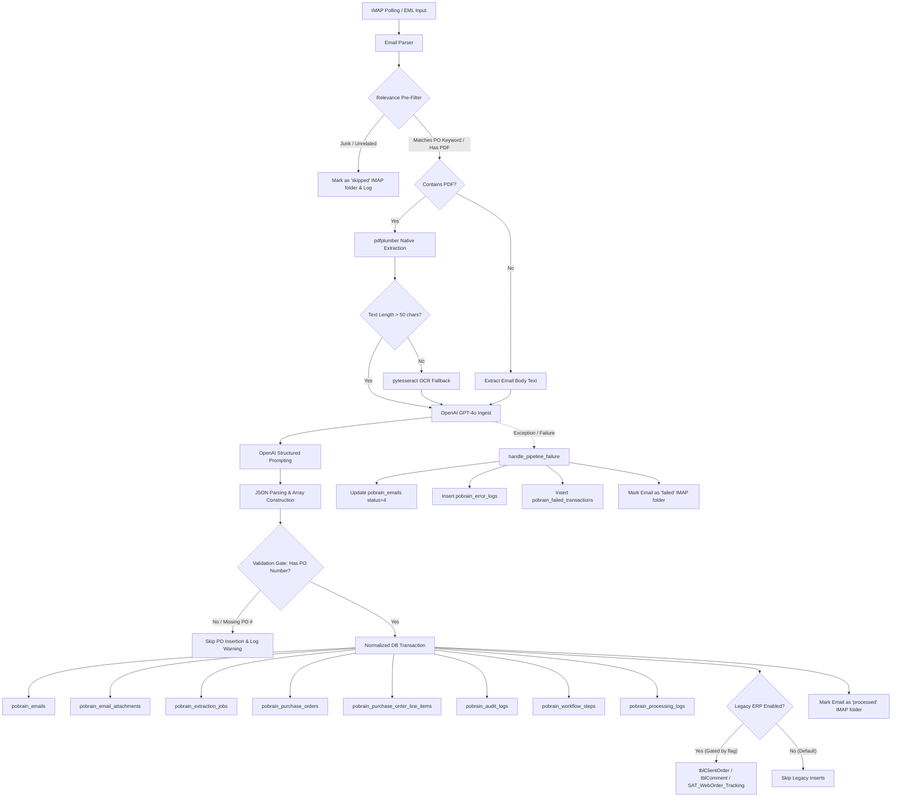

# PO-Brain — Python Code Architecture

This document provides a comprehensive overview of the architecture, data flow, component modules, and design decisions behind the Python extraction pipeline in PO-Brain. The primary entry point and production script is [unified_po_extractor.py](file:///e:/narayana/PO-Brain/Extraction_file/unified_po_extractor.py).

---

## 1. System Architecture Overview

The Python extraction pipeline is a standalone ingestion engine that coordinates:
1. **Email Ingestion:** Secure IMAP listening and polling.
2. **Document Parsing:** Local parsing of email bodies (text/HTML) and extraction of PDF attachments (native text + OCR fallback).
3. **Structured AI Extraction:** Prompt engineering using OpenAI GPT-4o to parse raw textual content into strict structured JSON PO data.
4. **Relational Database Storage:** Multi-table transaction commits into the normalized schema (`dbo.pobrain_*`) and optional legacy ERP tables in MS SQL Server.

### Core Data Flow Architecture



---

## 2. Core Components and Module Breakdown

The architecture of [unified_po_extractor.py](file:///e:/narayana/PO-Brain/Extraction_file/unified_po_extractor.py) is separated into distinct functional layers:

### 2.1 Configuration & Environment Settings
At the top of the script, global constants define authentication, API endpoints, connections, and extraction behaviors:
* **AI Engine Configurations:** OpenAI API key and target model (`gpt-4o`).
* **IMAP Mailbox Access:** Credentials and parameters for connecting to the target email inbox (`imap.gmail.com`).
* **SQL Server Database Parameters:** Server address, port, username, password, target database (`hyma_testdb`), and driver specification (`ODBC Driver 17 for SQL Server`).
* **Feature Toggle Flags:** Options such as `ENABLE_PO_PREFILTER` and `ENABLE_LEGACY_ERP_INSERT`.

### 2.2 Ingestion Layer (IMAP Client Watcher)
The `ImapClientWatcher` class encapsulates mailbox connectivity and message state transitions:
* **Connection & Selection:** Establish SSL connections and authenticates with Gmail IMAP. Selects the targeted folder (default: `INBOX`).
* **Unseen Searching:** Issues UID search command for `UNSEEN` emails and fetches RFC822 raw body parts.
* **Archiving & Relocation:** Implements secure email routing post-processing. Successful messages copy to the `processed` folder, failures route to `failed`, and pre-filtered spam routes to `skipped`. The messages are marked `\Seen` and deleted from `INBOX` via IMAP expunge.

### 2.3 Email & PDF Parsing Engine
Processes raw MIME documents and extracts text from attachments:
* **MIME Structure Resolver (`parse_email_structure`):** Traverses the email sections, decodes headers (using `decode_header`), extracts plain/HTML text, and isolates PDF payload attachments. HTML bodies are cleaned to raw text using `BeautifulSoup` (with `lxml` parser).
* **Dual-Path PDF Extractor (`extract_text_from_pdf`):**
  1. *Native Extractor:* Leverages `pdfplumber` to pull embedded text and page layout tables.
  2. *OCR Fallback:* If native text extraction yields sparse content (under 50 characters, standard for scanned PDFs), it routes to `pdf2image` to rasterize pages at 300 DPI, feeding the image matrices to `pytesseract` OCR to rebuild structured text.

### 2.4 Relevance Pre-Filter & Validation Gate
To reduce processing costs and maintain clean datasets, two structural checks gate the ingestion process:
1. **Relevance Pre-Filter (`is_likely_po_email`):** Runs before the OpenAI call or database inserts. Filters emails against a sender blocklist (e.g. `linkedin.com`, `notion.so`, `docusign.com`) and scans for PO keywords (e.g., `purchase order`, `PO No`, `indent`, `quotation`) in the subject or body. 
2. **Validation Gate (`save_parsed_data_to_db`):** Intercepts parsed data from the AI engine before DB write. Demands a valid extracted `po_number` (ensuring no blank placeholder POs are written to the master table) and discards completely empty line-item rows.

### 2.5 AI Extraction Engine (OpenAI Prompt Gateway)
Responsible for translation from raw text/OCR output to normalized JSON structures:
* **Prompt Engineering:** Feeds raw text alongside a comprehensive `_SYSTEM_PROMPT` to GPT-4o. The instructions define explicit mappings for 17 target fields (such as `po_number`, `vendor_name`, chemical properties like `cas_number` and `cat_number`, quantities, units of measure, unit prices, line amounts, and GST taxes).
* **Strict JSON Enforcement:** Demands output formatted as a JSON array of objects (one per line item) and prohibits explanation text or markdown blocks.
* **Post-Extraction Sanitizer (`clean_and_parse_json`):** Removes markdown fences (e.g., ` ```json `) and slices code blocks directly to isolate the array bounds `[...]` before loading with standard Python `json.loads`.

### 2.6 Persistence Layer (MS SQL Database Transactions)
Writes transactional and tracking records directly to SQL Server:
* **Connection Lifecycle Context (`_db_conn`):** Utilizes `pyodbc` connections inside a context manager to handle automatic transaction commits upon successful block execution or rollbacks in the event of an database error.
* **Master Records Mapping:** Writes to `pobrain_emails`, `pobrain_email_attachments`, and `pobrain_extraction_jobs` using identity output binds to capture primary keys for child records.
* **Relational PO Ingestion:** Records details across `pobrain_purchase_orders` (parent headers) and `pobrain_purchase_order_line_items` (child rows) with totals computed across the transaction block.
* **Audit, Logging & Traceability:** Inserts audit details into `pobrain_audit_logs` and writes execution timings to `pobrain_workflow_steps` for performance profiling.
* **Legacy Compatibility Mapper (`insert_into_legacy_tables`):** If enabled, queries `dbo.tblRegistration` to resolve a registered customer ID (`PersonID`) by email and writes records into `dbo.tblClientOrder`, `dbo.tblComment`, and `dbo.SAT_WebOrder_Tracking`.

---

## 3. Database Ingestion Layout

Here is the breakdown of database writes during pipeline states:

| Pipeline State | Target Database | Table Name | Type | Key Fields Ingested |
| :--- | :--- | :--- | :--- | :--- |
| **Ingestion Start** | `hyma_testdb` | `dbo.pobrain_emails` | `INSERT` | `mail_uid`, `email_from`, `email_subject`, `status_id = 2 (Processing)` |
| **Metadata Ingest** | `hyma_testdb` | `dbo.pobrain_email_attachments` | `INSERT` | `email_id`, `file_name`, `file_size_bytes`, `status_id = 12 (Parsing)` |
| **Job Registration** | `hyma_testdb` | `dbo.pobrain_extraction_jobs` | `INSERT` | `attachment_id`, `status_id = 22 (Extracting)`, `engine_id = 3` |
| **AI Output Received**| `hyma_testdb` | `dbo.pobrain_extraction_jobs` | `UPDATE` | `status_id = 23`, `raw_extraction_json`, `items_extracted`, `duration_ms` |
| **Data Commit (PO)** | `hyma_testdb` | `dbo.pobrain_purchase_orders` | `INSERT` | `po_number`, `vendor_name`, `total_quantity`, `total_amount`, `status_id = 31` |
| **Data Commit (Lines)**| `hyma_testdb` | `dbo.pobrain_purchase_order_line_items`| `INSERT` | `po_id`, `product_name`, `cas_number`, `quantity`, `unit_price`, `amount` |
| **Audit Trails** | `hyma_testdb` | `dbo.pobrain_audit_logs` | `INSERT` | `table_name = 'pobrain_purchase_orders'`, `action_type = 'INSERT'`, `new_values` |
| **Workflow Metric** | `hyma_testdb` | `dbo.pobrain_workflow_steps` | `INSERT` | `email_id`, `stage_id`, `status_id = 43 (Success)`, `duration_ms` |
| **Ingestion End** | `hyma_testdb` | `dbo.pobrain_emails` | `UPDATE` | `status_id = 3 (Completed)`, `processing_completed_at`, `duration_ms` |
| **Pipeline Failure** | `hyma_testdb` | `dbo.pobrain_emails` | `UPDATE` | `status_id = 4 (Failed)`, `failure_reason` |
| **Pipeline Failure** | `hyma_testdb` | `dbo.pobrain_error_logs` | `INSERT` | `email_id`, `error_code = 'PIPELINE_ERROR'`, `error_message`, `stack_trace` |
| **Pipeline Failure** | `hyma_testdb` | `dbo.pobrain_failed_transactions` | `INSERT` | `email_id`, `email_from`, `error_reason`, `is_reprocessed = 0` |

---

## 4. Run Modes & CLI Commands

The pipeline can be executed in several modes using command-line arguments:

```bash
# Verify database connection and exit
python unified_po_extractor.py --test-db

# Run continuous ingestion (polls target mailbox at configured intervals)
python unified_po_extractor.py

# Offline diagnostic: process a single local .eml file and store results in DB
python unified_po_extractor.py --file path/to/email.eml
```

---

## 5. Architectural Design Decisions & Trade-offs

1. **Implicit Fallback to OCR:** The extraction framework decides dynamically when to use OCR based on character counts. While this catches scanned documents and image files, converting PDFs to image matrices and using Tesseract represents a heavier CPU cost.
2. **Hardcoded Configurations:** Global credential parameters exist at the head of the file. Converting these parameters to environment variables (e.g. using `python-dotenv`) is flagged as a high priority architecture refinement.
3. **Decoupled Legacy ERP Ingestion:** Legacy table synchronization (`tblClientOrder`, etc.) is gated by a flag (`ENABLE_LEGACY_ERP_INSERT`). This decoupling ensures that validation or schema changes in legacy DB frameworks do not impact core `pobrain_*` logging and tracking metrics.
4. **Single-Process Model:** Designed as a single-process service that runs a polling loop. If throughput increases, it could be refactored into an event-driven system (e.g., Azure Functions or AWS Lambda) triggered by incoming mail hooks.
